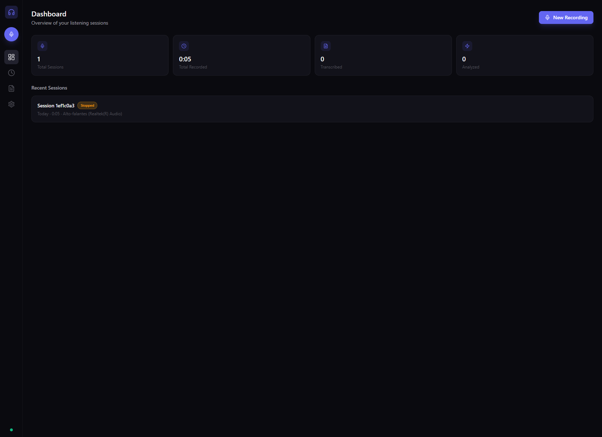
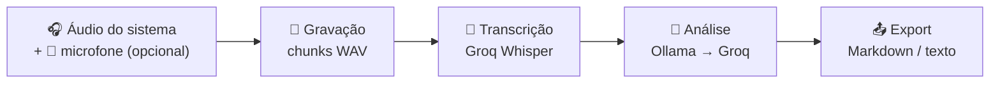
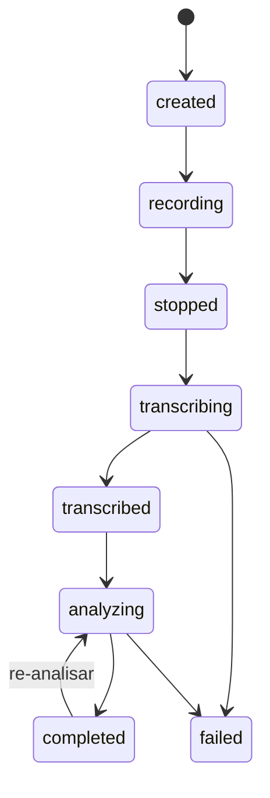
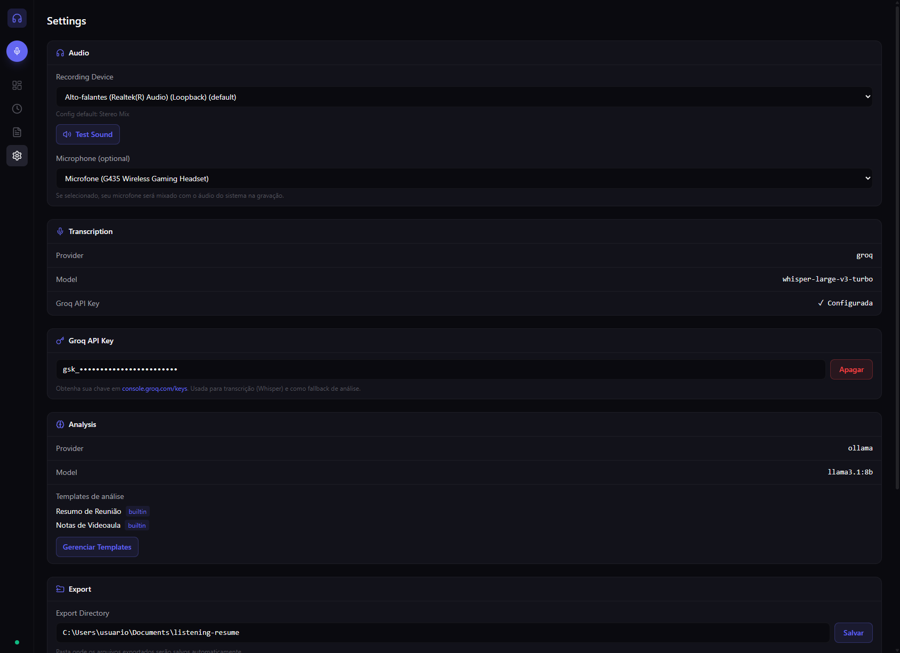
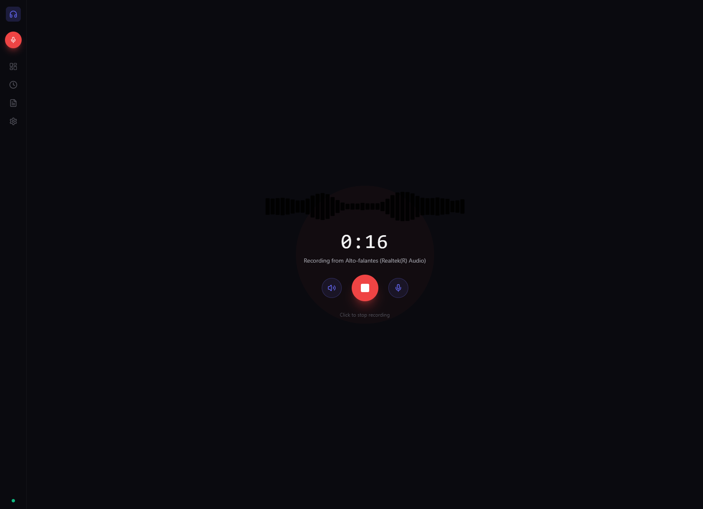
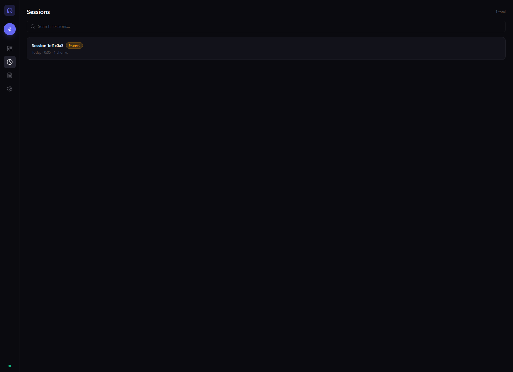
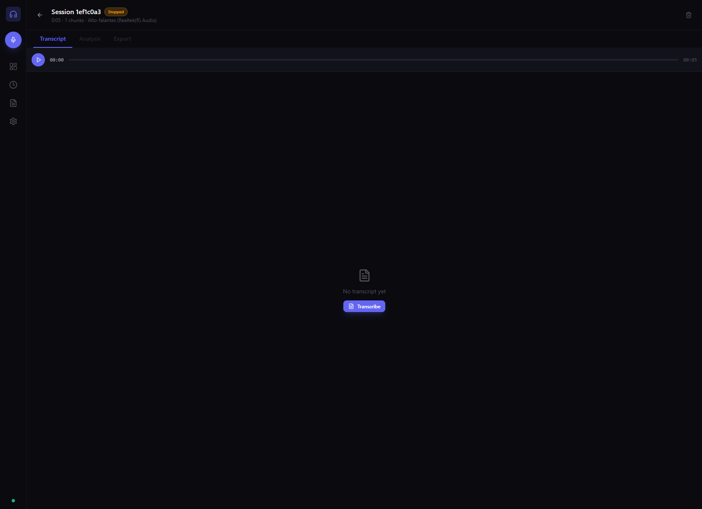
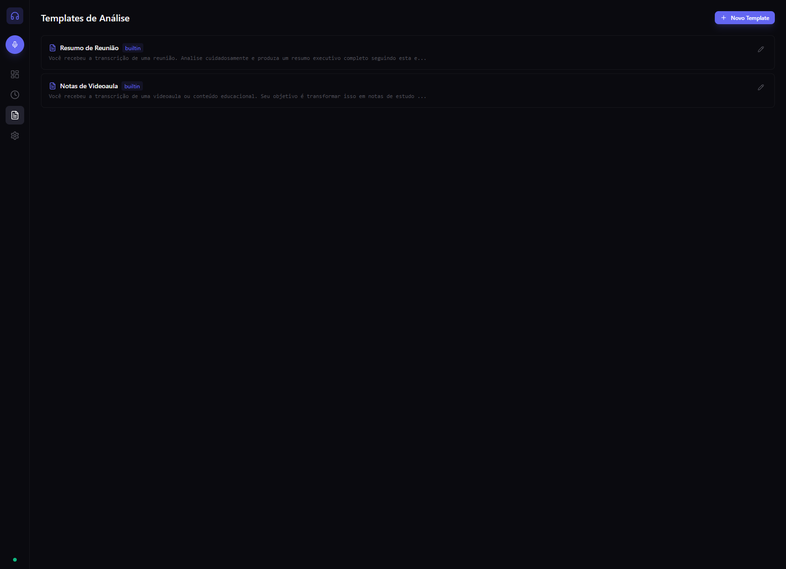

<div align="center">

# 🎧 Listening Resume

**Grave o que toca no seu PC → vire texto → vire resumo inteligente.**

Captura o áudio do sistema (reuniões, videoaulas, podcasts) — opcionalmente mixado com seu microfone —, transcreve automaticamente com Whisper e gera resumos com IA. Tudo num app desktop leve e **local-first**.




</div>

---

## Por que existe

Reuniões, aulas e podcasts passam e a informação se perde. Pedir a transcrição depois é trabalhoso, e ferramentas online exigem subir seu áudio pra nuvem. O **Listening Resume** resolve isso no seu próprio computador:

- **Captura direto da placa de som** — não precisa de "Stereo Mix", cabo virtual ou plugin. No Windows usa um binário nativo **WASAPI loopback**; no Linux, PipeWire/PulseAudio.
- **Seu áudio não vai pra lugar nenhum** — gravações, transcrições e análises ficam no seu disco. Só o texto vai pra API de IA que **você** escolher (ou roda 100% local com Ollama + whisper-cpp).
- **Do áudio ao resumo em 3 cliques** — gravar → transcrever → analisar.

---

## ✨ Destaques

| | |
|---|---|
| 🎚️ **Áudio do sistema + microfone** | Grava a saída do PC e, opcionalmente, mixa seu mic — com **soft-limiter** pra não estourar |
| 🔇 **Mute ao vivo** | Silencie sistema ou mic **durante** a gravação, sem afetar o que você ouve |
| 🗣️ **Transcrição automática** | Whisper via Groq (rápido) ou whisper-cpp/OpenAI |
| 🧠 **Análise com IA** | Resumos e notas via Ollama (local) com fallback automático pro Groq |
| 🧩 **Templates personalizáveis** | Prompts prontos (reunião, videoaula) ou crie os seus com `{{transcript}}` |
| ▶️ **Player com navegação** | Toque o áudio e pule clicando num trecho da transcrição ou na barra |
| 📤 **Export** | Markdown ou texto, download ou salvo direto na pasta configurada |
| 🪟 **Nativo e discreto** | App Tauri leve; no Windows o backend roda **sem janela de console** |
| 💻 **GUI + CLI** | Use a interface ou rode headless pela linha de comando |

---

## 🔄 Como funciona



Cada gravação é uma **sessão**, que avança por uma máquina de estados:



---

## 🧭 Passo a passo (interface)

### 1. Dashboard — visão geral
Total de sessões, tempo gravado, quantas foram transcritas/analisadas e as gravações recentes. **New Recording** (ou o microfone na lateral) começa uma gravação.


### 2. Settings — configurar antes de gravar
- **Recording Device** — qual saída capturar (loopback do sistema). **Test Sound** toca um tom *no dispositivo selecionado* pra confirmar.
- **Microphone (opcional)** — se escolhido, é **mixado** com o áudio do sistema.
- **Groq API Key** — cole sua chave (`gsk_...`) → **Salvar**. Usada na transcrição e como fallback de análise.
- **Analysis** — provider/modelo (Ollama local ou Groq) e templates.
- **Export Directory** — pasta de saída dos arquivos exportados.



### 3. Gravar
Forma de onda animada, cronômetro e o dispositivo em uso. Botões: 🔊 mute do sistema · ⏹️ parar · 🎤 mute do mic. O mute vale **só pra gravação**.



### 4. Sessions — suas gravações
Lista com status, duração e dispositivo, com busca. Clique para abrir o detalhe.



### 5. Detalhe — transcrever, analisar, exportar
Player com seek + três abas:
- **Transcript** — gera a transcrição; cada trecho tem timestamp clicável que pula o áudio.
- **Analysis** — escolhe um template e gera o resumo (Ollama → fallback Groq); pode rodar de novo.
- **Export** — Markdown/texto, download ou salvar na pasta de export.



### 6. Templates — personalizar a análise
Dois prontos (**Resumo de Reunião**, **Notas de Videoaula**) e os seus — basta o prompt conter `{{transcript}}`, substituído pela transcrição na hora.



---

## 📦 Instalação

### Usuário final

| SO | Como |
|----|------|
| **Windows** | Baixe e rode o instalador `Listening Resume_x.y.z_x64-setup.exe`. FFmpeg, FFplay e Node já vêm embutidos — sem configurar nada de áudio. |
| **Linux** | Instale o `.deb` (`sudo dpkg -i ...`). Requer `ffmpeg` e PipeWire/PulseAudio no sistema. |

### A partir do código

```bash
pnpm install        # dependências
pnpm dev            # GUI em desenvolvimento (Vite :1420 + API :3456)
```

Build dos instaladores (rode no SO alvo):

```bash
pnpm --filter gui build:windows   # → .exe (NSIS) em apps/gui/src-tauri/target/release/bundle/nsis/
pnpm --filter gui build:linux     # → .deb em .../bundle/deb/
```

> O build do Windows valida a si mesmo: um *smoke-test* sobe o servidor empacotado e checa `GET /api/devices` antes de gerar o instalador — se o bundle quebrar, o build falha.

---

## ⚙️ Configuração de IA

Pelo menos um provider. Configure pela tela **Settings** ou via `.env` na raiz:

```bash
cp .env.example .env
```

```env
GROQ_API_KEY=gsk_...
```

| Provider | Uso | Como |
|----------|-----|------|
| **Groq** ⭐ | Transcrição + Análise | `GROQ_API_KEY` (rápido, recomendado) |
| **Ollama** | Análise local | `ollama serve` + modelo (ex.: `llama3.1:8b`) |
| **whisper-cpp** | Transcrição local | binário local |
| **OpenAI** | Transcrição + Análise | `OPENAI_API_KEY` |
| **Anthropic** | Análise | `ANTHROPIC_API_KEY` |

> 💡 Combinação 100% offline: **Ollama** (análise) + **whisper-cpp** (transcrição) — nenhum dado sai do PC.

---

## 🏗️ Arquitetura

Monorepo pnpm com **arquitetura hexagonal** (ports & adapters) no core — a lógica de negócio não conhece detalhes de plataforma, só interfaces.

```
listening-resume/
├── packages/core/          # @listening-resume/core — lógica pura
│   ├── domain/             #   modelos, estados, erros
│   ├── ports/              #   interfaces (AudioCapture, Transcriber, Analyzer, ...)
│   ├── adapters/           #   implementações por plataforma/provider
│   │   ├── audio/          #     WASAPI (Windows) · PipeWire/Pulse (Linux)
│   │   ├── transcription/  #     Groq Whisper · whisper-cpp
│   │   ├── analysis/       #     Ollama · Groq
│   │   └── persistence/    #     SQLite (Drizzle) · arquivos · export Markdown
│   └── application/        #   serviços (Recording, Transcription, Analysis)
├── apps/gui/               # Desktop: React 19 + Vite 6 + servidor Node + Tauri 2
│   └── src-tauri/          #   wrapper Rust + binário nativo de captura WASAPI
└── apps/cli/               # CLI (Commander.js)
```

No Windows, a captura de áudio é um binário **Rust/WASAPI** dedicado (`wasapi-capture`): grava o loopback no formato nativo do device, mixa o microfone (resample + soft-limiter), aceita comandos de mute em tempo real e ainda renderiza o tom de "Test Sound" no dispositivo escolhido.

---

## 🧱 Stack

| Camada | Tecnologia |
|--------|-----------|
| Frontend | React 19 · Tailwind CSS · Zustand · Vite 6 |
| Desktop | Tauri 2 (Rust) |
| Backend | Node.js (servidor HTTP embarcado, porta 3456) |
| Captura (Win) | Rust + crate `wasapi` (loopback nativo) |
| Captura (Linux) | FFmpeg + PipeWire/PulseAudio |
| Banco | SQLite (better-sqlite3 + Drizzle ORM) |
| Transcrição | Whisper (Groq / OpenAI / whisper-cpp) |
| Análise | LLMs (Ollama / Groq / OpenAI / Anthropic) |
| Lint/Format | Biome · TypeScript strict |

---

## 🔐 Privacidade

- **Local-first**: áudio, transcrições e análises ficam em `%LOCALAPPDATA%\listening-resume` (Windows) ou `~/.local/share/listening-resume` (Linux).
- O servidor HTTP escuta **só em localhost** e tem guarda de origem.
- Áudio **nunca** é enviado para a nuvem — apenas o **texto** vai para o provider de IA que você configurar (e nada sai se usar Ollama + whisper-cpp).

---

## 🛠️ Comandos úteis

| Comando | Descrição |
|---------|-----------|
| `pnpm dev` | GUI em desenvolvimento |
| `pnpm build` | Build de todos os pacotes |
| `pnpm test` | Testes (unit + integração + e2e) |
| `pnpm lint` | Biome em todo o monorepo |
| `pnpm listen` | CLI: inicia gravação |
| `pnpm --filter gui build:windows` | Instalador `.exe` (Windows) |
| `pnpm --filter gui build:linux` | Pacote `.deb` (Linux) |

---

## 📄 Licença

Projeto pessoal.
