<div align="center">

# 🎧 Listening Resume

**Assista à aula. As anotações ficam por conta dele.**

Grave videoaulas, vídeos do YouTube, reuniões e podcasts direto do seu computador,
transforme em texto e receba um resumo pronto para estudar ou relembrar o conteúdo.

[](https://github.com/Bizzye/listening-resume/releases/latest)


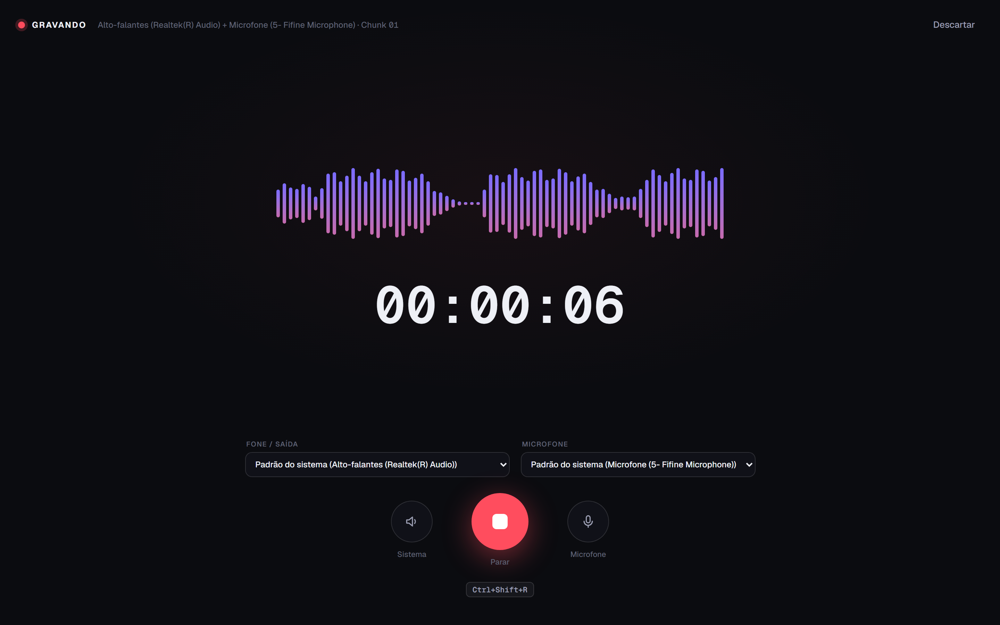

<sub>Print tirado durante uma gravação real: as barras sobem quando há som e ficam baixas no silêncio.</sub>

</div>

---

## 🎓 Por que eu criei

Eu estudo muito por videoaula e vídeo do YouTube, e vivia pausando a cada 30 segundos para anotar. Uma aula de 1 hora virava 2, e no fim eu tinha um caderno bagunçado.

Então escrevi um app que grava o que está tocando no computador, transcreve e monta o caderno da aula sozinho. Agora eu presto atenção na aula, e as anotações saem prontas no final.

## 💡 O que é

O **Listening Resume** é um aplicativo para computador que funciona como um "gravador inteligente":

1. **Grava** o som que está tocando no PC (uma videoaula, um vídeo do YouTube, uma reunião no Meet/Teams, um podcast) junto com a sua voz no microfone.
2. **Transcreve** tudo automaticamente, ou seja, transforma o áudio em texto, com o horário de cada fala.
3. **Resume** o conteúdo com inteligência artificial, no formato que você escolher: caderno completo da aula (conceitos, fórmulas, exercícios e glossário), flashcards para revisar, resumo executivo, ata de reunião ou artigo.
4. **Exporta** o resultado para Word, PDF ou Markdown.

Tudo em português e com uma interface simples, pensada para quem não é da área de tecnologia.

## ✨ O que ele faz

| | |
|---|---|
| 🎙️ **Grava o PC e o microfone juntos** | Não precisa de cabo nem de programa extra: o app capta o som do computador direto do Windows |
| 🌊 **Mostra o som ao vivo** | A onda na tela se mexe de acordo com o áudio real, então você vê na hora se está gravando |
| 🔀 **Troca de fone ou microfone sem parar** | Plugou outro fone no meio da reunião? Troque na tela e a gravação continua |
| 🖥️ **Opção "Padrão do sistema"** | Usa automaticamente o dispositivo que o Windows está usando, mesmo se ele mudar no meio do caminho |
| 🔇 **Silenciar por fonte** | Desliga só o microfone ou só o som do PC da gravação, e avisa se nada estiver sendo captado |
| 📝 **Transcrição com horário** | Clique em uma frase e o áudio pula para aquele momento |
| 🧠 **Resumos prontos em pt-BR** | Modelos de Videoaula (caderno da aula e estudo completo em 12 seções), Flashcards (Anki), Resumo Executivo, Ata de Reunião e Podcast → Artigo, além dos que você criar |
| 📤 **Exporta para Word, PDF e Markdown** | Salva na pasta que você escolher |
| 📥 **Importa arquivos** | Também transcreve áudios e vídeos que você já tem |
| 🌗 **Tema claro e escuro** | |

## 🧭 Conhecendo o app

| Primeiro uso: o app testa o seu som | Painel inicial |
|---|---|
| 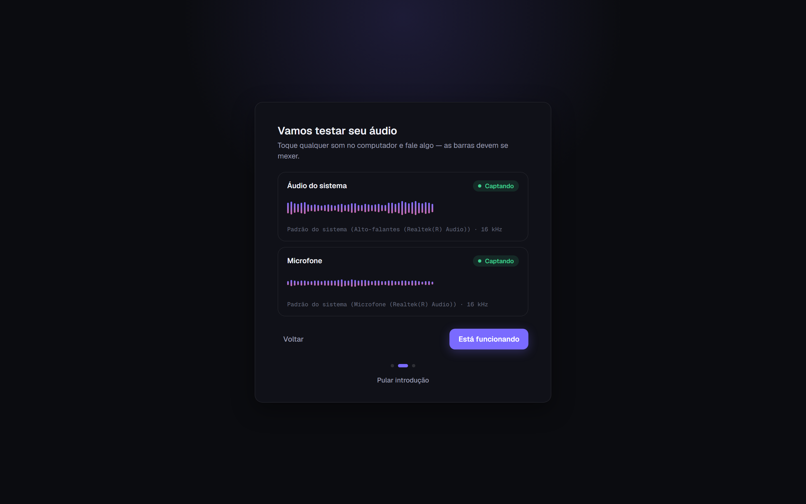 | 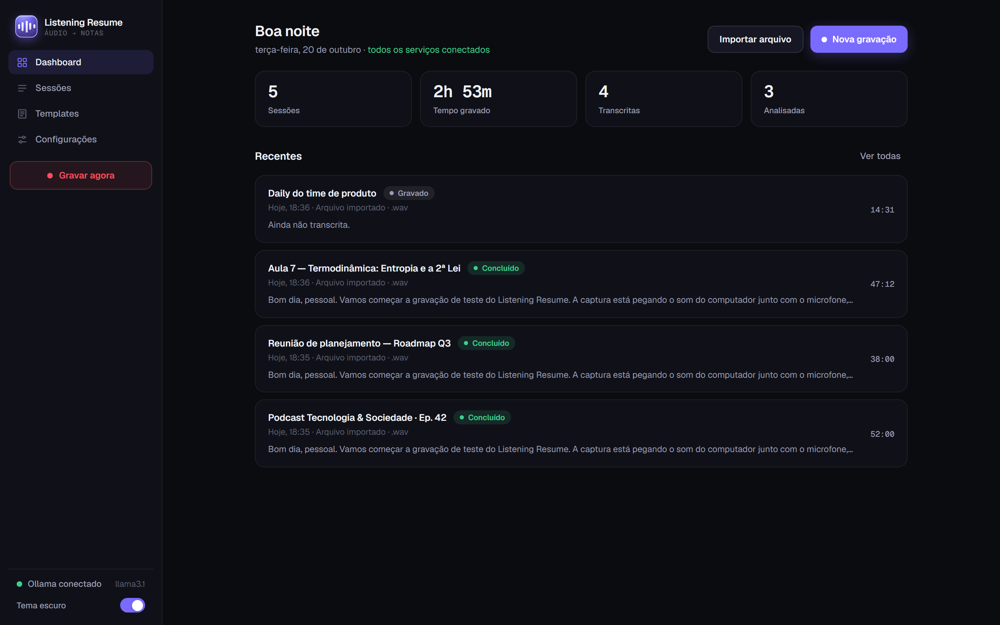 |

| Gravando | Trocando o microfone sem parar a gravação |
|---|---|
| 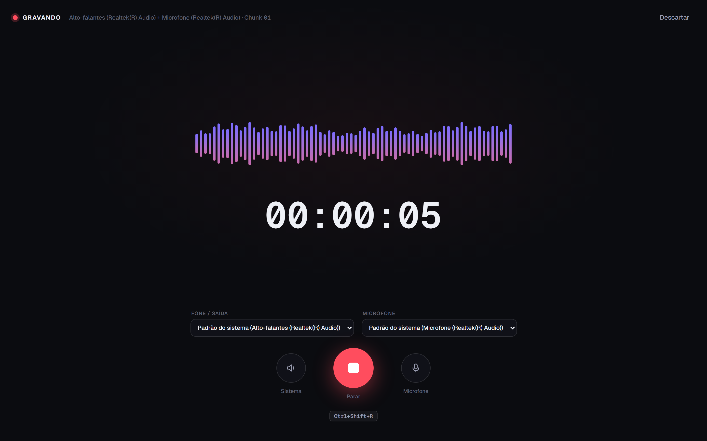 | 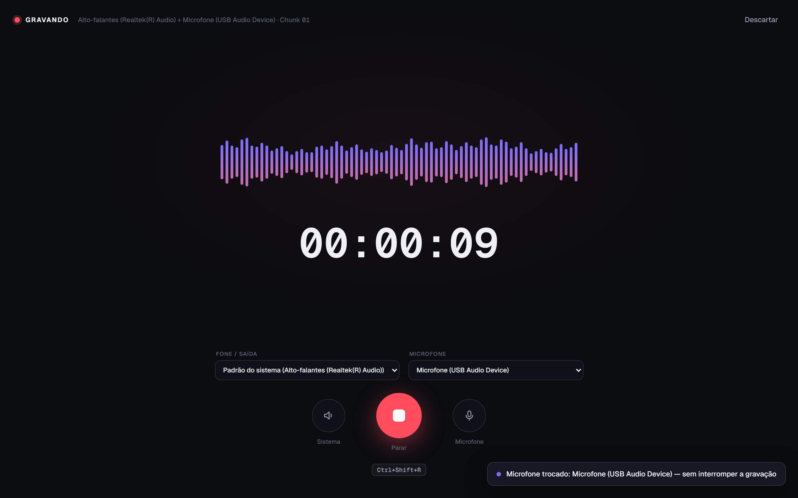 |

| Lista de gravações | Transcrição com player |
|---|---|
| 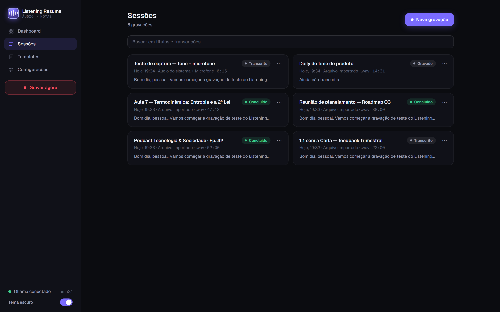 | 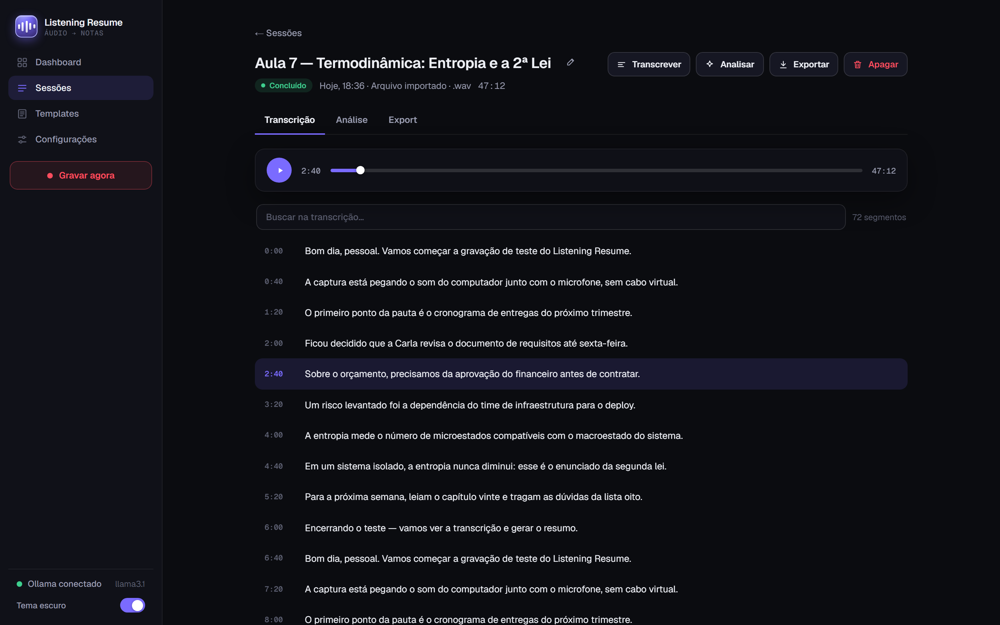 |

| Resumo gerado pela IA | Flashcards para estudar |
|---|---|
| 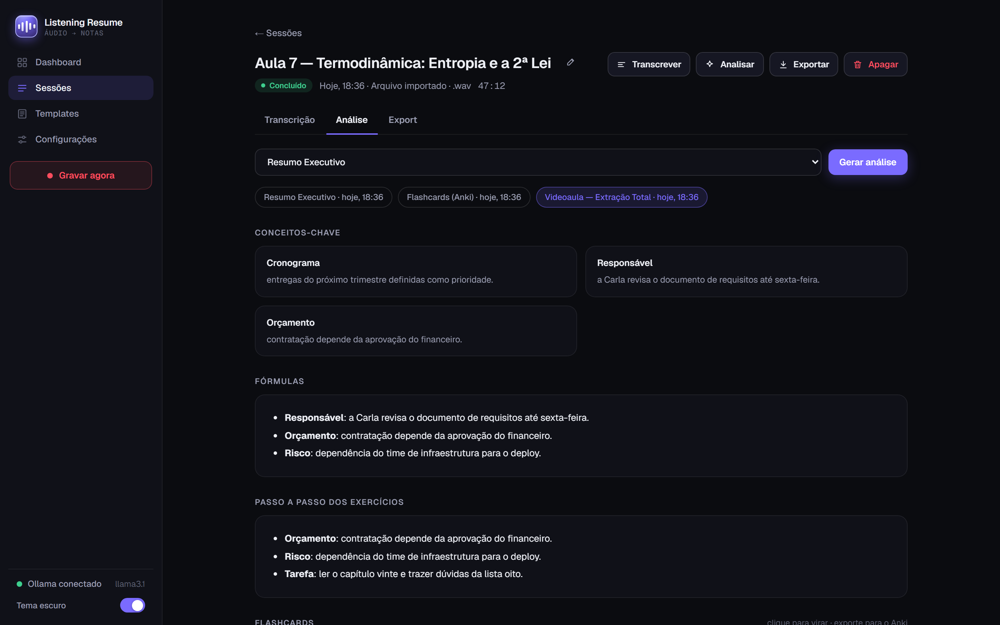 | 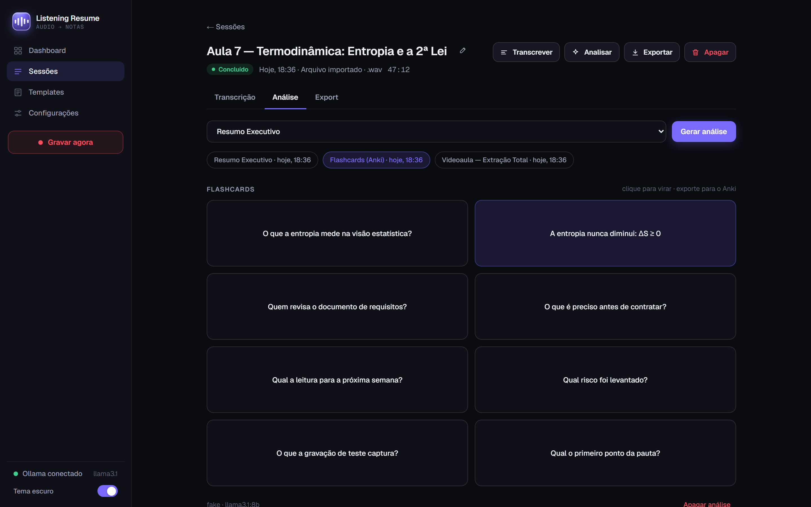 |

| Exportar | Modelos de resumo |
|---|---|
| 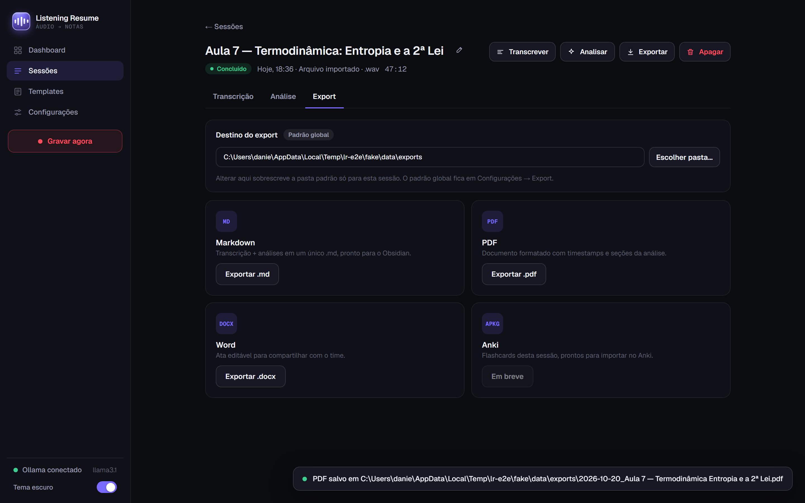 | 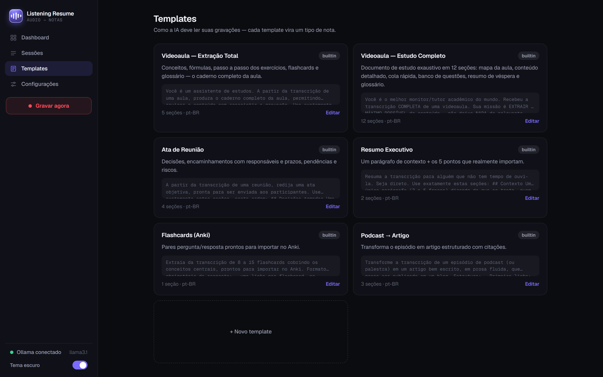 |

| Configurações | Tema claro |
|---|---|
| 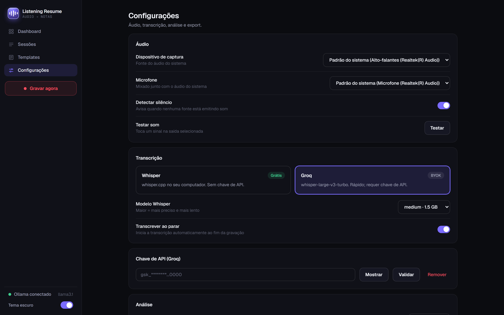 | 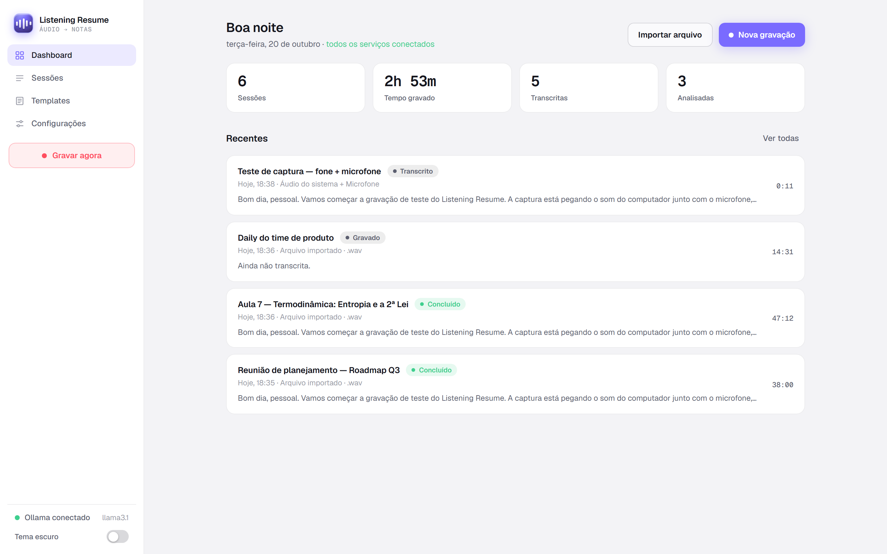 |

## ⬇️ Como instalar (Windows)

1. Abra a página de [**Downloads**](https://github.com/Bizzye/listening-resume/releases/latest) e baixe o arquivo `LR-…-setup.exe`.
2. Dê dois cliques no arquivo baixado e siga o instalador (Avançar → Instalar).
3. Abra o **Listening Resume** pelo menu Iniciar. Na primeira vez, ele mostra um passo a passo rápido.

> **O Windows mostrou "O Windows protegeu o computador"?** Isso acontece com programas novos que ainda não têm assinatura digital paga. Clique em **Mais informações → Executar assim mesmo**.

**Para transcrever e resumir**, o app precisa de um serviço de inteligência artificial. O jeito mais fácil:

- Crie uma chave gratuita em [console.groq.com](https://console.groq.com/keys) e cole em **Configurações → Chave de API (Groq)**.
- Opcional, para funcionar sem internet: instale o [Ollama](https://ollama.com) (resumos) e o whisper.cpp (transcrição).

A gravação funciona mesmo sem nenhuma chave configurada.

## 🗓️ Como o projeto foi construído

O desenvolvimento foi organizado em sprints curtas, cada uma com um objetivo claro:

| Sprint | Objetivo | Resultado |
|---|---|---|
| **1. Fundação** | Primeira versão funcional | Gravação, transcrição e resumo funcionando, ainda com interface simples |
| **2. Windows de verdade** | Gravar o som do PC sem programas extras | Motor de captura próprio para Windows, mistura do microfone sem distorção, instalador |
| **3. Novo design** | Uma interface bonita e fácil | Design completo criado e importado como referência visual (todas as telas, modo claro e escuro) |
| **4. Reconstrução** | Reescrever o app para seguir o design e ficar fácil de manter | Interface nova idêntica ao design, onda que reage ao som real, troca de dispositivos ao vivo, opção "Padrão do sistema", código reorganizado em partes independentes |
| **5. Revisão e segurança** | Encontrar problemas antes do usuário | Quatro revisões completas de código; mais de 80 problemas encontrados e corrigidos, incluindo duas falhas de segurança graves |
| **6. Testes** | Garantir que tudo funciona e continua funcionando | Mais de 660 testes automáticos, incluindo testes que usam o app como uma pessoa usaria e um teste no hardware real |
| **7. Entrega** | Deixar pronto para qualquer pessoa usar | Instalador para Windows, documentação, prints de todas as telas e verificação automática a cada mudança (CI) |

## ✅ Qualidade em números

- **660+ testes automáticos** em três camadas: 548 testes de unidade, 85 de integração e 29 de ponta a ponta (o robô abre o app, grava, transcreve, resume e exporta).
- **Teste em hardware real**: a duração gravada bateu com o relógio com diferença de até **0,05 segundo**.
- **Segurança**: o app só aceita conexões do próprio computador e bloqueia sites que tentem controlá-lo.
- **Privacidade**: gravações, textos e resumos ficam salvos **no seu computador**. Só vai para a internet o que for enviado ao serviço de IA que você escolher.

---

## 🛠️ Para desenvolvedores

<details>
<summary>Stack, arquitetura, comandos e estrutura</summary>

### Stack

Tauri 2 (desktop) · React 19 + Zustand + Vite 6 (interface) · Node.js (API local) · Rust (captura WASAPI) · SQLite + Drizzle · Zod · Vitest · Playwright · Biome.

Arquitetura hexagonal (ports & adapters) no `packages/core`, servidor HTTP modular com injeção de dependências, binário de captura em Rust com um núcleo puro testado (DSP, protocolo, máquina de estados).

### IA

| Provider | Uso | Como |
|---|---|---|
| **Groq** | Transcrição (Whisper) + fallback da análise | Chave `gsk_...` em Configurações (ou `GROQ_API_KEY` no `.env`) |
| **Ollama** | Análise local (primário) | `ollama serve` + um modelo, por exemplo `ollama pull llama3.1:8b` |
| **whisper.cpp** | Transcrição local | `whisper-cli` no PATH + `ggml-<modelo>.bin` em `<dados>/models` |

### Rodando localmente

Requer Node 22+, pnpm 12, Rust stable e, no Windows, PowerShell 7.

```bash
pnpm install
pnpm --filter @listening-resume/core build   # a GUI e a CLI consomem o core via dist/
pnpm --filter gui build:wasapi               # Windows: compila o wasapi-capture.exe
pnpm dev                                     # Vite :1420 + API :3456
pnpm listen devices                          # CLI (lista dispositivos)
```

| Comando | O que faz |
|---|---|
| `pnpm test` | Todas as camadas: unit + integração + e2e |
| `pnpm test:unit` | core + GUI (UI e servidor) + Rust (`cargo test --bin wasapi-capture`) |
| `pnpm test:integration` | core + servidor HTTP real em porta efêmera |
| `pnpm test:e2e` | CLI + Playwright (backend fake hermético) |
| `pnpm test:hardware` | Playwright com captura **real** (toca bipes na saída padrão) |
| `pnpm screenshots` | Regenera `docs/images/01–18` |
| `pnpm lint` / `pnpm format` | Biome |
| `pnpm --filter gui build:windows` | Instalador NSIS/MSI, copiado para `exe/LR-<data>-<versão>-setup.exe` |
| `pnpm --filter gui build:linux` | Pacote `.deb` |

### Estrutura

```
packages/core/      @listening-resume/core: hexagonal (domain · ports · adapters · application · config · templates · utils)
                    + @listening-resume/core/shared (entrada segura para o browser)
apps/gui/
├── src/            React 19 + Zustand (app · features · shared · store · styles)
├── server.ts       entrada da API → server/ (app, http guard, router, routes, services, bootstrap)
├── src-tauri/      Tauri 2 (lib.rs) + src/bin/wasapi-capture/ (captura WASAPI em Rust)
├── e2e/            Playwright
└── tests/          ui · server/unit · server/integration
apps/cli/           CLI (Commander)
docs/images/        prints de todas as telas (gerados por `pnpm screenshots`)
```

### Dados e privacidade

- Áudio, transcrições e análises ficam em `%LOCALAPPDATA%\listening-resume` (Windows) ou `~/.local/share/listening-resume` (Linux).
- A API escuta **só em loopback**, com guard de Host, Origin e Fetch-Metadata.
- Só o áudio de transcrição (no caso do Groq) e o texto da análise vão para o provider que **você** configurar.

</details>

## 👋 Autor

Feito por [@Bizzye](https://github.com/Bizzye). Se o app te ajudou a estudar, deixa uma ⭐ no repositório e me conta o que achou nas [issues](https://github.com/Bizzye/listening-resume/issues).

## 📄 Licença

Código aberto sob a licença [MIT](LICENSE): pode usar, estudar, modificar e distribuir, mantendo o aviso de copyright.
